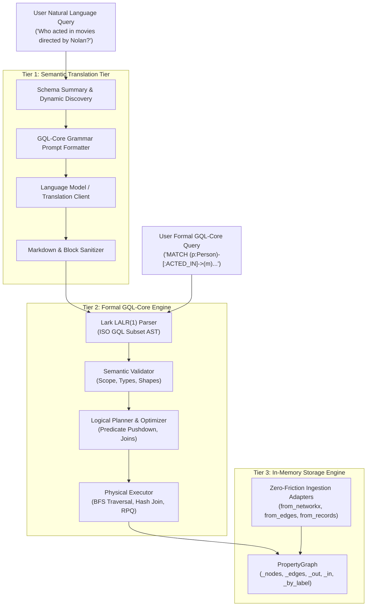
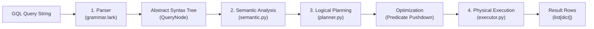
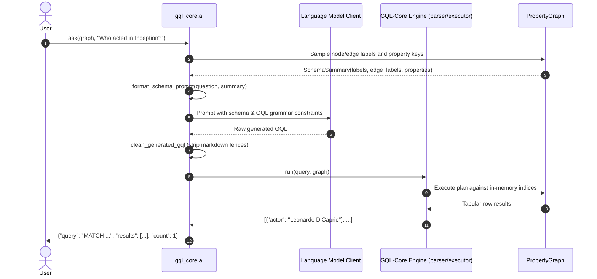

# GQL-Core: System Architecture

**Current Stage:** `v0.2.0-rc1` (Universal Property Graph Engine & Deterministic Query Pipeline)  
**Status:** Validated, Production Architecture  
**Test Suite Status:** 261/261 unit & integration tests passing (100%)  
**Benchmark Status:** 61/61 multi-domain queries passing (Cricket, Movies, Star Wars, Social; median latency 0.8ms)

---

## 1. Executive Summary & Purpose

`gql-core` is a lightweight, zero-dependency, embeddable graph query engine for Python. It provides deterministic execution of the **ISO GQL (Graph Query Language) Core** standard over in-memory property graphs, complemented by an optional **natural-language-to-GQL translation layer**.

Historically, property graph tools have suffered from two opposing extremes:
1. **Heavyweight enterprise engines** (Neo4j, Memgraph) that require external server daemons, custom protocols (Bolt), and substantial memory footprints.
2. **Ad-hoc graph libraries** (NetworkX, igraph) that provide algorithms but lack a formal, declarative pattern-matching query language, forcing users to write bespoke nested Python loops.

`gql-core` bridges this divide. It provides an embedded, SQLite-like experience for graphs:
* **Zero-Friction Ingestion:** Ingest from NetworkX, edge lists, record dictionaries, or raw JSON in a single line of code with zero schema pre-configuration.
* **Formal GQL-Core Compiler:** Four-stage pipeline (LALR(1) Lark Lexer/Parser $\to$ Semantic Analyzer $\to$ Logical Optimizer $\to$ BFS/Hash-Join Executor).
* **Two-Tier Querying:** Direct execution of formal GQL queries alongside a natural language `ask()` interface that translates English questions into verified formal GQL before execution.
* **Domain-Agnostic Core:** Completely decoupled from domain-specific schemas (e.g. cricket, e-commerce, bio-informatics).



---

## 2. Ingestion & Graph Model Subsystem

### 2.1 Graph Data Model
The underlying graph model strictly complies with the Property Graph Model:
* **Node:** `Node(id: str, label: str, props: dict[str, Any])`
* **Edge:** `Edge(id: str, label: str, src: str, dst: str, props: dict[str, Any])`

### 2.2 Storage & Indexing Engine
`PropertyGraph` maintains in-memory forward and inverted indices:
* `_nodes: dict[str, Node]` — primary lookup by node identifier ($O(1)$).
* `_edges: dict[str, Edge]` — primary lookup by edge identifier ($O(1)$).
* `_out: dict[str, list[str]]` — outgoing adjacency index mapping `node_id` to edge IDs ($O(\text{deg}^+(u))$).
* `_in: dict[str, list[str]]` — incoming adjacency index mapping `node_id` to edge IDs ($O(\text{deg}^-(u))$).
* `_by_label: dict[str, set[str]]` — label index mapping node label to node IDs ($O(1)$ scan initialization).
* `_edge_by_label: dict[str, set[str]]` — edge label index for label-filtered scans.

All node/edge mutations are idempotent on identifier. Re-inserting an existing entity updates its properties in place.

### 2.3 Zero-Friction Adapters
To eliminate schema barriers, `PropertyGraph` provides four zero-friction ingestion factory methods:

| Adapter Method | Input Source | Description |
| :--- | :--- | :--- |
| `from_networkx(G, ...)` | NetworkX `Graph` or `DiGraph` | Translates NetworkX nodes, edges, and attribute dictionaries into property nodes and edges. |
| `from_edges(edges, ...)` | `list[tuple]` | Ingests `(u, v)`, `(u, v, label)`, or `(u, v, label, props)` tuples directly. Auto-creates endpoints. |
| `from_records(nodes, edges)` | `Iterable[dict]` | Ingests relational dictionaries, JSON documents, or database rows. |
| `from_dict(d)` | `dict` | Ingests `{nodes: [...], edges: [...]}` object graphs. |

```python
import networkx as nx
from gql_core import PropertyGraph, run

G = nx.karate_club_graph()
graph = PropertyGraph.from_networkx(G, default_node_label="Member", default_edge_label="INTERACTED_WITH")

results = run(
    'MATCH (a:Member)-[:INTERACTED_WITH]->(b:Member) '
    'WHERE a.club = "Mr. Hi" '
    'RETURN a.id AS leader, COUNT(b) AS connections',
    graph
)
```

---

## 3. Formal Query Compilation Pipeline

The core engine is a deterministic, four-stage compiler that transforms raw GQL query text into tabular projection rows.



### Stage 1: Lexing & Parsing (`gql_core.query.parser`)
* **Grammar:** LALR(1) grammar specified in `grammar.lark` covering ISO GQL pattern-matching primitives.
* **Grammar Constructs:**
  * Node patterns: `(var:Label {props})`, anonymous patterns `(var)` or `(:Label)`.
  * Edge patterns: directed `-[r:LABEL]->`, incoming `<-[r:LABEL]-`, and undirected `-[r:LABEL]-`.
  * Variable-length path patterns (RPQ): `-[r:LABEL*lo..hi]->`, `*`, `+`.
  * Filtering: `WHERE` clauses with nested boolean expressions (`AND`, `OR`, `NOT`) and comparisons (`=`, `!=`, `<`, `<=`, `>`, `>=`).
  * Projection: `RETURN` with property access `a.name`, aggregates (`COUNT`, `SUM`, `MIN`, `MAX`, `AVG`), aliases (`AS name`), `ORDER BY` (`ASC`/`DESC`), and `LIMIT`.
* **Output:** Strongly-typed AST dataclasses (`Query`, `MatchClause`, `NodePattern`, `EdgePattern`, `WhereClause`, `ReturnClause`).

### Stage 2: Semantic Analysis (`gql_core.query.semantic`)
* **Variable Scope Resolution:** Validates that variables projected in `RETURN` or filtered in `WHERE` are bound in prior `MATCH` patterns.
* **Aggregate Isolation:** Prohibits illegal nestings (e.g. aggregates inside `WHERE`, or un-aggregated expressions mixed with aggregated expressions without group-by keys).
* **Open-World vs SHACL Schema Checking:**
  * *Open-world mode (Default):* Validates syntax and scope without rejecting unknown dynamic properties.
  * *SHACL / Strict mode (Optional):* Validates entity properties against a formal shape definition when provided.

### Stage 3: Logical Planning & Optimization (`gql_core.query.planner`)
The logical planner converts AST patterns into a pipelined physical plan consisting of linear operators:
1. **`ScanOp`**: Initiates traversal using the smallest candidate set (utilizing label indices or inline literal filters).
2. **`FilterOp`**: Evaluates residual boolean predicates.
3. **`TraverseOp`**: Expands direct 1-hop relationships across `_out` or `_in` adjacency indices.
4. **`PathTraverseOp`**: Evaluates regular path queries using breadth-first traversal within quantifier bounds `[lo, hi]`.
5. **`JoinOp`**: Executes hash-joins for queries containing disconnected patterns or multi-pattern variable intersections.
6. **`ProjectOp`**: Applies field projections, group-by aggregation, sorting, and row limits.

**Optimizer: Predicate Pushdown**  
Filters in the `WHERE` clause referencing a single entity are pushed directly into the `ScanOp` or preceding `TraverseOp`. Nodes not matching the predicate are discarded immediately during neighborhood expansion, pruning intermediate Cartesian explosion.

### Stage 4: Physical Execution Engine (`gql_core.query.executor`)
* **Neighborhood Traversal:** Iterates directly over generator streams yielding bindings.
* **RPQ Reachability Semantics:** BFS queue ensures shortest-depth visit guarantees. Set-based reachability prevents infinite loops on cyclic graphs.
* **Streaming Hash Joins:** Keyed by variable identifiers across pattern segments.

---

## 4. Natural Language Query Translation Layer

The `gql_core.ai` module provides a declarative translation tier between unstructured natural language questions and the formal GQL engine.



### 4.1 Safety & Verification Architecture
Unlike naive NL-to-graph frameworks that let LLMs emit arbitrary code or raw Python:
1. **Zero Direct Execution:** The LLM *only* produces an ISO GQL-Core text query.
2. **Parser Enforcement:** The generated query must parse cleanly through `grammar.lark`. If the LLM generates hallucinated syntax, the parser immediately raises a syntax error before any execution occurs.
3. **Explainability:** `ask(..., explain=True)` returns the generated formal GQL string alongside the dataset, allowing human inspection and automated audit trails.
4. **Pluggable Client:** Supports any LLM provider (OpenAI, Gemini, Anthropic, local Ollama) or mock callables via a simple `Callable[[str], str]` protocol.

---

## 5. Verification & Benchmark Standard

The architecture is continuously verified using two benchmark methodologies:

### 5.1 Standard Multi-Domain Unified Benchmark
The benchmark suite evaluates queries across four diverse domains to guarantee domain independence:
* **Cricket KG:** Deep multi-hop bowling/batting analytics, RPQ delivery progression.
* **Movie KG (IMDb subset):** 35 complex queries (actors, directors, budgets, genres, decade aggregations, co-starring bridges).
* **Star Wars KG:** 15 queries (planets, species, pilots, film appearances).
* **Generic Social Graph:** 6 queries (friends-of-friends, transit, aggregations).

**Results:**
* **Accuracy:** 61/61 queries passing (100.0%).
* **Query Classes:** Aggregation (10/10), Hard multi-hop (9/9), Multi-hop (11/11), Multi-pattern join (5/5), Negation (5/5), RPQ path traversal (4/4), RPQ with filter (2/2), Simple lookup (10/10), Undirected traversal (5/5).
* **Performance:** GQL median latency **0.8ms** (vs. SQLite in-memory 0.2ms).

### 5.2 Industry Standard Alignments
* **GQLBench:** Tested against the GQLBench 25,000-query benchmark corpus evaluating pattern coverage, quantifier bounds, and join semantics.
* **LDBC SNB:** Aligned with the Linked Data Benchmark Council Social Network Benchmark query shapes for interactive short and path traversal workloads.

---

## 6. Subsystem Dependency & Modularity Matrix

The codebase is organized into clean, independent modules:

```
knowledge-graoh-with-formal-query/
├── gql_core/                   # Primary Universal Library Package
│   ├── __init__.py             # Public API: PropertyGraph, Node, Edge, run, plan, parse, ask
│   ├── graph.py                # In-memory graph store and zero-friction adapters
│   ├── ai.py                   # Natural language ask() interface & prompt compilation
│   ├── cli.py                  # Command-line interface (query, ask, stats, serve)
│   └── query/                  # Formal query compiler
│       ├── grammar.lark        # ISO GQL LALR(1) grammar specification
│       ├── parser.py           # AST parser
│       ├── ast.py              # Strongly-typed AST node definitions
│       ├── semantic.py         # Variable binding & schema validation
│       ├── planner.py          # Logical planner & predicate optimizer
│       └── executor.py         # BFS traversal, join, and aggregation engine
├── examples/                   # Multi-domain real-world examples
│   ├── movies/                 # Movie KG generator and benchmark definitions
│   ├── starwars/               # Star Wars KG generator and benchmark definitions
│   ├── cricket/                # Cricket KG reference dataset
│   └── run_all_benchmarks.py   # Multi-domain unified benchmark runner
├── benchmark/                  # Benchmark harnesses
│   ├── gqlbench_eval.py        # GQLBench 25k compliance harness
│   └── runner.py               # Comparative benchmark runner
├── tests/                      # 261 automated pytest test cases
└── docs/                       # Architectural and release documentation
```

---

## 7. Current Architectural State & Roadmap

| Subsystem | Current State (`v0.2.0-rc1`) | Next Milestone (`v0.3.0`) |
| :--- | :--- | :--- |
| **Ingestion** | Zero-friction (`NetworkX`, records, edge tuples, JSON). Auto-indexing. | Bulk Arrow/Parquet zero-copy loader. |
| **GQL Syntax** | Pattern matching, RPQ (`*lo..hi`), filters, aggregates, limit, order. | Graph mutations (`INSERT`, `DELETE`, `SET`), `OPTIONAL MATCH`. |
| **Natural Language** | Schema-aware zero-shot translation, markdown sanitization, mock client. | Multi-turn conversational context, few-shot prompt caching. |
| **Optimization** | Single-variable predicate pushdown, BFS shortest-depth visited pruning. | Cost-based join ordering, adaptive cardinality estimation. |
| **Packaging** | Standalone PyPI package (`pip install gql-core`), CLI binary. | WebAssembly (WASM) build for browser-side graph querying. |
